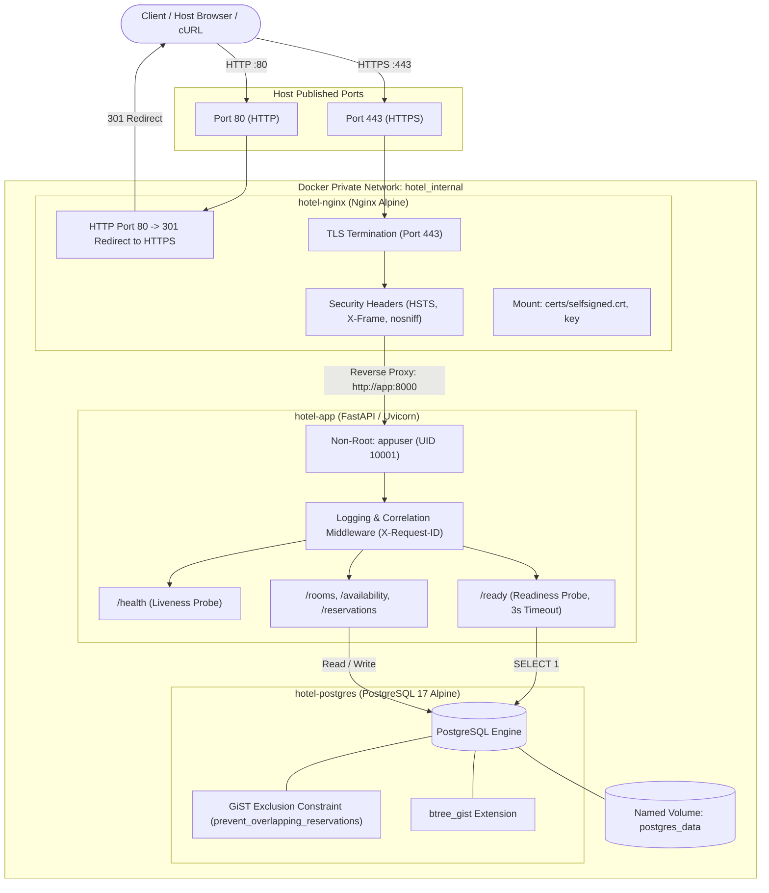
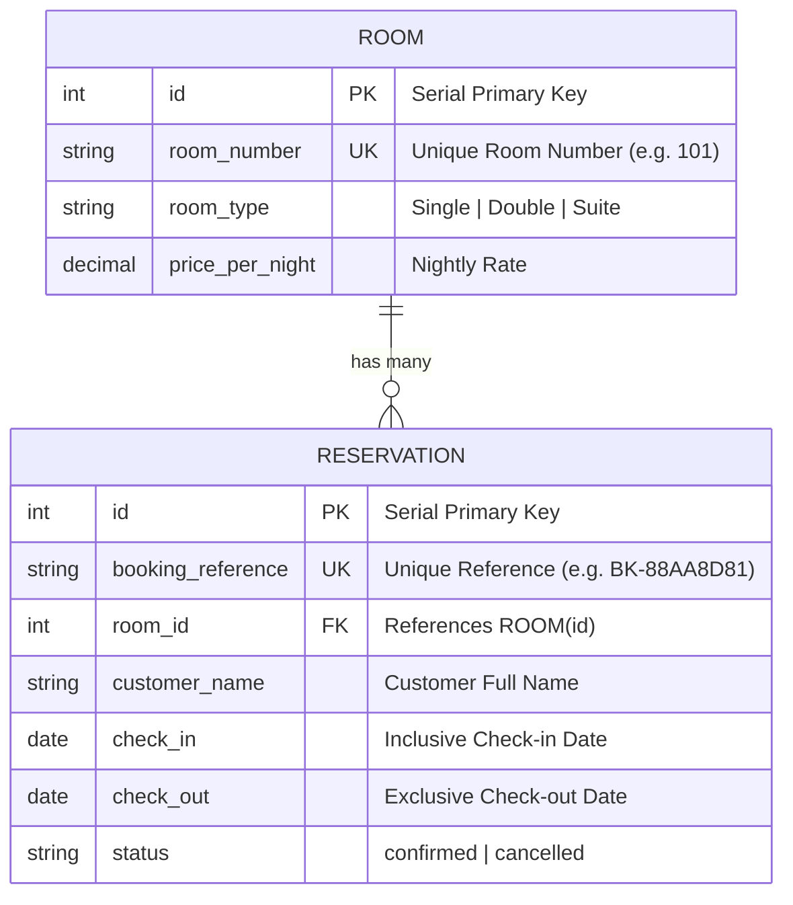

# Cloud Deployment & CI/CD: Hotel Booking Platform

[](https://github.com/drax102/Devops_Hotel_assignment/actions/workflows/ci.yml)

A production-grade, containerized Room Availability and Reservation Service built for the **ALGIONS AI LABS DevOps & Cloud Engineering** assessment.

This project delivers high concurrency resilience, automated continuous integration, strict container security, TLS-encrypted ingress with Nginx, structured observability, and zero-downtime disaster recovery.

---

## Architecture Overview

The system runs as an isolated multi-container architecture orchestrated via Docker Compose:



---

## Entity-Relationship & Concurrency Architecture

Double-booking prevention is enforced at the storage engine level via a native PostgreSQL GiST exclusion constraint (`prevent_overlapping_reservations`). Even under aggressive parallel concurrency, race conditions are mathematically prevented.



### Exclusion Constraint Specification
```sql
ALTER TABLE reservations 
ADD CONSTRAINT prevent_overlapping_reservations 
EXCLUDE USING gist (
    room_id WITH =, 
    daterange(check_in, check_out, '[)') WITH &&
) 
WHERE (status = 'confirmed');
```
Any attempt to insert a conflicting confirmed reservation raises a PostgreSQL exclusion violation, which FastAPI catches and translates into an immediate `HTTP 409 Conflict`.

---

## Quick Start (Clean Clone)

### Prerequisites
- Docker Desktop (WSL2 engine on Windows, or Docker Engine on Linux/macOS)
- PowerShell 5.1+ (Windows) or Bash

### 1. Clone & Configure Environment
```powershell
git clone https://github.com/drax102/Devops_Hotel_assignment.git
cd Devops_Hotel_assignment
Copy-Item .env.example .env
```

### 2. Generate Local TLS Certificates
```powershell
powershell -ExecutionPolicy Bypass -File scripts/generate_certs.ps1
```
Generates a self-signed TLS certificate (`certs/selfsigned.crt` and `certs/selfsigned.key`) valid for `localhost` and `127.0.0.1`.

### 3. Start Service Stack
```powershell
docker compose up -d
```
Docker Compose launches:
- `hotel-postgres`: Runs PostgreSQL 17 Alpine on internal bridge `hotel_internal`.
- `hotel-app`: Automatically executes `alembic upgrade head` and starts FastAPI on port 8000 as `appuser:10001`.
- `hotel-nginx`: Terminates TLS on port 443, enforces HTTPS redirection from port 80, injects security headers, and reverse proxies upstream to `hotel-app`.

### 4. Verify Health & TLS Termination
```powershell
# 1. Test HTTP to HTTPS 301 redirect
curl.exe -i http://localhost/health

# 2. Test HTTPS liveness probe (200 OK)
curl.exe -k -i https://localhost/health

# 3. Test HTTPS readiness probe (verifies database connectivity)
curl.exe -k -i https://localhost/ready
```

### 5. Seed Database
```powershell
docker compose exec app python scripts/seed.py
```

### 6. Create a Reservation over HTTPS
```powershell
$body = '{"room_id":1,"customer_name":"John Doe","check_in":"2026-12-01","check_out":"2026-12-05"}'
$body | curl.exe -s -k -i -X POST https://localhost/reservations -H "Content-Type: application/json" -d "@-"
```

---

## Environment Variables

| Variable | Default Value | Description |
| :--- | :--- | :--- |
| `POSTGRES_DB` | `hotel_db` | Primary PostgreSQL database name |
| `POSTGRES_USER` | `hotel_user` | PostgreSQL database user |
| `POSTGRES_PASSWORD` | `local_dev_password_123` | PostgreSQL password (change in production) |
| `POSTGRES_HOST` | `db` | Database hostname inside Docker network |
| `POSTGRES_PORT` | `5432` | Database port inside Docker network |
| `APP_PORT` | `8000` | Port on which FastAPI binds inside container |
| `LOG_LEVEL` | `INFO` | Logging level (`DEBUG`, `INFO`, `WARNING`, `ERROR`) |
| `ENVIRONMENT` | `development` | Deployment environment identifier |
| `APP_VERSION` | `local` | Image tag version for deployment/rollback |

---

## Port Map

| Service | Internal Port | Published Port | Description | Access Policy |
| :--- | :--- | :--- | :--- | :--- |
| `hotel-nginx` | `80/tcp` | `80/tcp` | HTTP Redirect (301 -> HTTPS) | Public / Host |
| `hotel-nginx` | `443/tcp` | `443/tcp` | HTTPS Reverse Proxy & TLS | Public / Host |
| `hotel-app` | `8000/tcp` | None (prod) / `8000` (dev) | FastAPI HTTP REST API | Bridge only (Dev override `127.0.0.1:8000`) |
| `hotel-postgres` | `5432/tcp` | None (prod) / `5432` (dev) | PostgreSQL Database | Bridge only (Dev override `127.0.0.1:5432`) |

---

## API Endpoints Catalog

| Method | Path | Description | Response Codes |
| :--- | :--- | :--- | :--- |
| `GET` | `/health` | Liveness probe (checks process state) | `200 OK` |
| `GET` | `/ready` | Readiness probe (verifies database `SELECT 1` with 3s timeout) | `200 OK`, `503 Service Unavailable` |
| `GET` | `/rooms` | List all hotel rooms | `200 OK` |
| `GET` | `/rooms/{room_id}` | Retrieve room details by ID | `200 OK`, `404 Not Found` |
| `POST` | `/rooms` | Create a new room | `201 Created`, `400 Bad Request` |
| `GET` | `/availability` | Search available rooms for date range | `200 OK`, `400 Bad Request` |
| `GET` | `/reservations` | List existing reservations | `200 OK` |
| `POST` | `/reservations` | Book a room with GiST concurrency protection | `201 Created`, `409 Conflict`, `404 Not Found` |
| `DELETE` | `/reservations/{code}` | Cancel a reservation | `200 OK`, `404 Not Found` |

---

## Continuous Integration & Versioned Container Publishing

The GitHub Actions CI pipeline runs on every push and pull request to `main`:
- **Linting & Code Quality**: `ruff check .` and `black --check .`
- **Database Migrations & Test Suite**: PostgreSQL 17 service container, `alembic upgrade head`, and `pytest -v -s` with 100% passing tests including 10-thread parallel race-condition verification.
- **Docker Build & Push**: On release tags (`v*`), builds multi-platform image and pushes signed, versioned image to GitHub Container Registry (GHCR).

### Real GHCR Published Release
- **Repository**: `ghcr.io/drax102/devops_hotel_assignment`
- **Release Tag**: `1.0.0`
- **Index Digest**: `sha256:9fc1f38d9fdd9beaf19a310253f2d9ff50c2277369791fe4acff293f6fe38f14`
- **Verified Run**: [Workflow Run 43717288264](https://github.com/drax102/Devops_Hotel_assignment/actions/runs/43717288264)

---

## Operations: Backup, Recovery & Rollbacks

### Database Backup & Restore
- **Backup**:
  ```powershell
  powershell -ExecutionPolicy Bypass -File scripts/backup.ps1
  ```
  Creates an atomic, compressed binary dump (`-Fc`) preserving the GiST exclusion constraint.
- **Restore**:
  ```powershell
  powershell -ExecutionPolicy Bypass -File scripts/restore.ps1
  ```
- **Automated Verification**:
  ```powershell
  powershell -ExecutionPolicy Bypass -File scripts/demo_backup_restore.ps1
  ```

### Release Deployment & Instant Rollback
- **Deploy specific release**:
  ```powershell
  $env:APP_VERSION = "v1.0.0"; docker compose up -d app
  ```
- **Rollback on failure**:
  ```powershell
  $env:APP_VERSION = "v1.0.0"; docker compose up -d app
  ```
- **Automated Verification**:
  ```powershell
  powershell -ExecutionPolicy Bypass -File scripts/rollback_drill.ps1
  ```

For detailed guides, refer to:
- [Operational Runbook](file:///docs/runbook.md)
- [Troubleshooting Guide](file:///docs/troubleshooting.md)

---

## Verification Evidence Catalog

All evidence files contain raw, unedited terminal outputs captured on the system:

| # | Evidence File | Verified Activity |
| :-: | :--- | :--- |
| **01** | [`evidence/01_baseline_audit.txt`](file:///evidence/01_baseline_audit.txt) | Environment audit (Python 3.13.5, Windows 11, clean git tree) |
| **02** | [`evidence/02_alembic_migration.txt`](file:///evidence/02_alembic_migration.txt) | Migration execution & PostgreSQL GiST exclusion constraint inspection |
| **03** | [`evidence/03_seed_verification.txt`](file:///evidence/03_seed_verification.txt) | Idempotent seeder verification (run twice consecutively, 0 duplicates) |
| **04** | [`evidence/04_pytest_full.txt`](file:///evidence/04_pytest_full.txt) | Full test suite passing (10 concurrent requests: 1x 201 Created, 9x 409 Conflict) |
| **05** | [`evidence/05_docker_build_compose.txt`](file:///evidence/05_docker_build_compose.txt) | Multi-stage Docker build (322MB, non-root user), Compose startup, healthcheck |
| **06** | [`evidence/06_ci_pipeline.txt`](file:///evidence/06_ci_pipeline.txt) | GitHub Actions API extraction for PR & main green runs |
| **07** | [`evidence/07_image_digest.txt`](file:///evidence/07_image_digest.txt) | `v1.0.0` GHCR build, remote digest inspection, pull by digest & test |
| **08** | [`evidence/08_observability_failure_drill.txt`](file:///evidence/08_observability_failure_drill.txt) | Outage drill: DB failure detected, readiness 503, JSON logs, self-healing |
| **09** | [`evidence/09_backup_restore.txt`](file:///evidence/09_backup_restore.txt) | Database backup, data wipe, full restoration, and volume persistence drill |
| **10** | [`evidence/10_rollback_drill.txt`](file:///evidence/10_rollback_drill.txt) | Deployment regression drill: buggy v1.0.1 deployed and rolled back to v1.0.0 |
| **11** | [`evidence/11_nginx_https.txt`](file:///evidence/11_nginx_https.txt) | Nginx TLS termination, port 80 redirect, security headers, HTTPS booking |

See [`evidence/INDEX.md`](file:///evidence/INDEX.md) for full descriptions.

---

## Known Gaps & Current Scope

1. **Kubernetes / Cloud Multi-Node Clustering**:
   - *Status*: Deliberately out of scope. Per assessment guidelines, single-node Docker Compose on local infrastructure with reproducible scripting is the mandated target architecture.
2. **ACME / Let's Encrypt Automated Certificate Issuance**:
   - *Status*: Production environments with registered domain names would use Let's Encrypt / Certbot. For local self-contained evaluation, automated generation of an X.509 certificate with Subject Alternative Names (`DNS:localhost, IP:127.0.0.1`) is implemented and verified.
